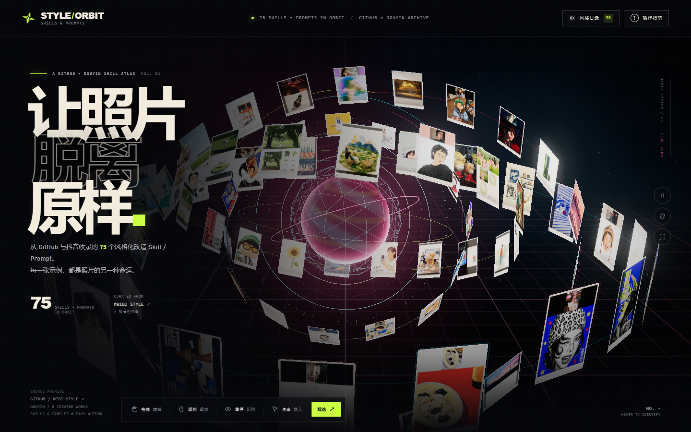
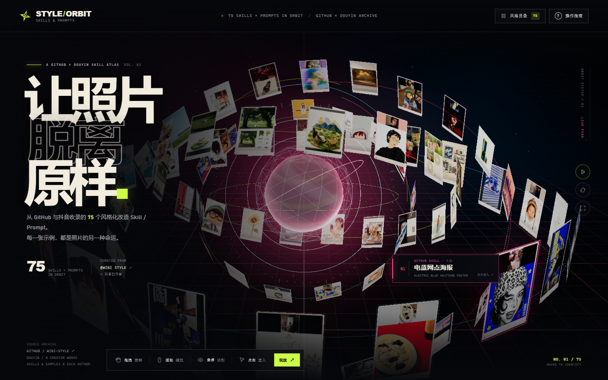
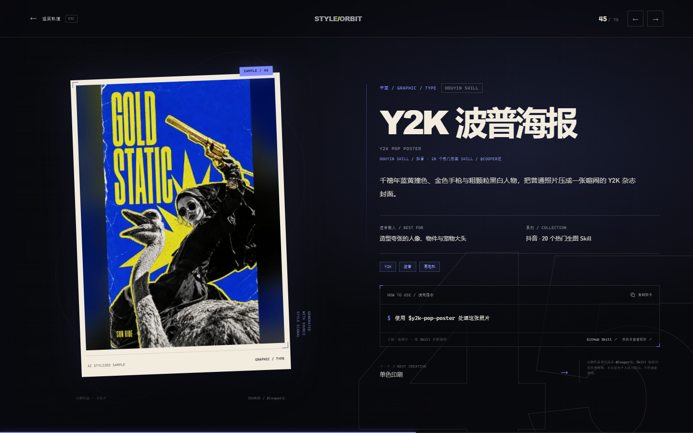
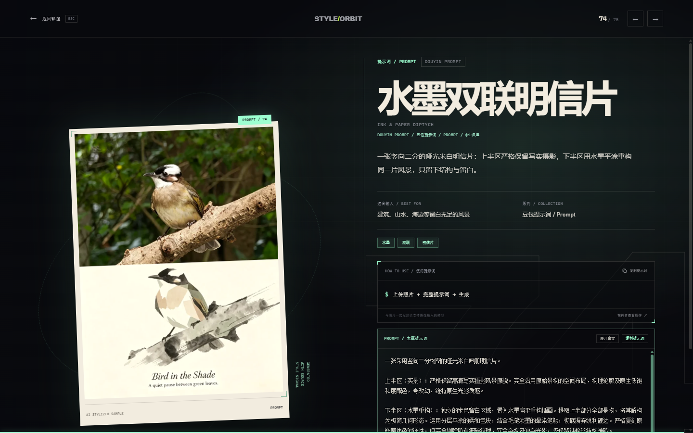
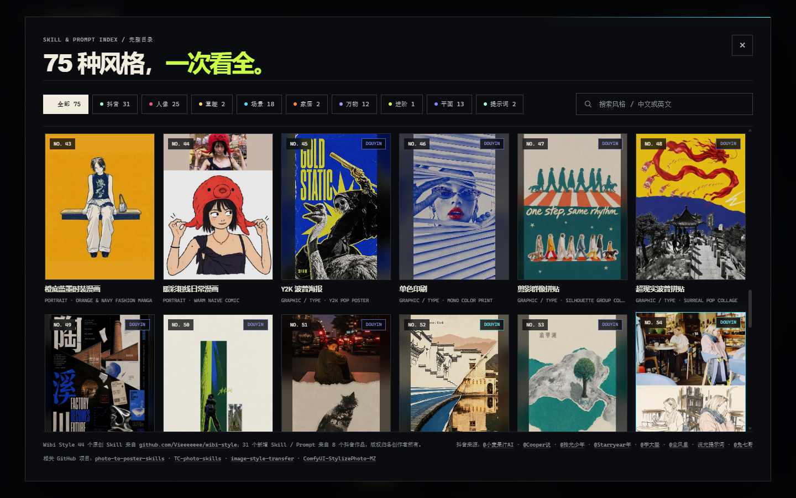
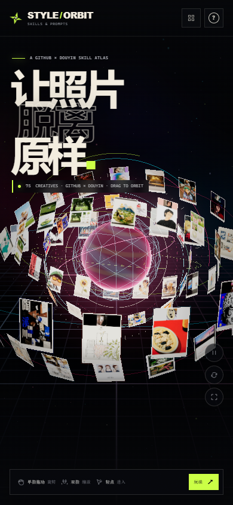
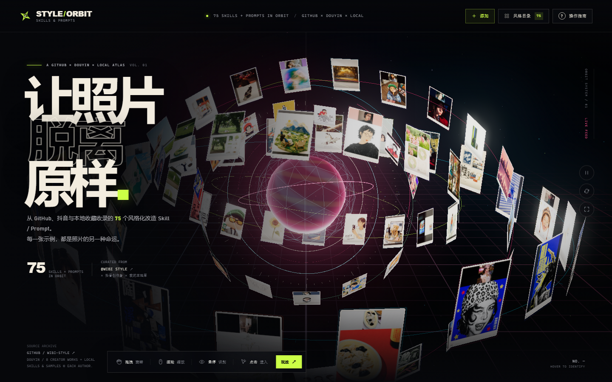
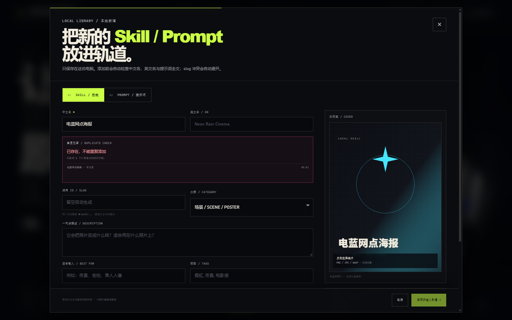

# STYLE / ORBIT

**风格化照片 Skill / Prompt 的 3D 轨道画廊** — 把来自 GitHub 与抖音的 75 个风格化改造创意，以及你自己的本地 Skill / Prompt，放进一座可以旋转、缩放、悬停、点开和持续添加的轨道宇宙。现已提供 Windows 便携桌面版。

[在线体验](https://mubai0102.github.io/styleverse/) · [Windows 便携版下载](https://github.com/MUBAI0102/styleverse/releases/latest) · [源码仓库](https://github.com/MUBAI0102/styleverse)

网站由 GitHub Actions 自动构建并部署到 GitHub Pages，推送到 `main` 后会自动更新。Windows 下载包请从 Releases 获取，完整解压后运行 `STYLE-ORBIT.exe`。



| 悬停识别 | Skill 详情页 |
| --- | --- |
|  |  |

| Prompt 详情 | 完整目录 |
| --- | --- |
|  |  |

| 手机视图 | 操作指南 |
| --- | --- |
|  |  |

| Windows 桌面版 | 本地添加面板 |
| --- | --- |
|  |  |

## 这是什么

本项目收录并可视化两个来源：

- **Wibi Style**：[Vieeeeeee/wibi-style](https://github.com/Vieeeeeee/wibi-style) 的 **44 个原创视觉风格 Skill**，原样保留每一张示例卡面。
- **八条抖音作品**：用户整理并提供的 Skill / 提示词参考，去重后新增 **29 个 Skill + 2 个完整提示词**，共 31 个条目。

内置总计 **75 个条目（73 Skill + 2 Prompt）**；桌面版启动后会在此基础上加载你的本地库，数量动态增加。每一条都有中文名、英文名、适合输入、视觉描述和来源链接；有完整提示词的条目可以在详情页展开、滚动阅读并一键复制。部分同名风格在多条作品中重复出现时只建一张卡，例如 `gathered-scenes-zine-skill` 与 `surreal-pop-collage`，它们的补充提示词合并进了同一条目。

内置 75 张照片分布在**四条**不同倾角、不同公转速度的轨道上（22 + 20 + 18 + 15），围绕中央的程序化能量核运行；新增本地条目会自动分配进轨道。所有环形轨道、卡片、边框、粒子、星空、网格、核心球体、辉光与界面图形都由代码生成；页面不加载任何外部 3D 模型，也不在运行时请求网络资源。

> 这不是一张渲染好的图片，而是一个可在浏览器里自由探索的实时 Three.js 场景。

## 交互一览

| 操作 | 结果 |
| --- | --- |
| 按住画面拖动 | 自由绕轨道旋转视角 |
| 滚轮 / 双指捏合 | 缩放靠近或拉远 |
| 指针悬停照片 | 照片浮起、发光；其余照片聚焦变暗，并显示来源、分类与风格名 |
| 单击 / 轻点照片 | 卡片发光闪烁、粒子爆裂，随后进入全屏详情页 |
| 详情页 `←` / `→`、键盘方向键 | 在 75 个条目之间前后切换 |
| 详情页复制按钮 | Skill 复制调用指令；Prompt 复制完整提示词 |
| 详情页「展开全文」 | 展开长提示词阅读区域 |
| `Esc` | 关闭详情页 / 操作指南 / 技能目录 |
| `R` | 平滑重置视角 |
| `Space` | 暂停 / 恢复自动巡航 |
| 顶部「添加」 | 打开本地新增面板；可添加 Skill / Prompt、上传封面、粘贴完整提示词 |
| 顶部「风格目录」 | 打开全部条目的完整 2D 索引，支持 8 个分类、抖音新增与本地库筛选和搜索 |
| 详情页「编辑 / 删除」 | 只对本地库条目显示，修改或移除后自动重新校准轨道 |
| 顶部「操作指南」/ 底部「玩法」 | 查看完整操作说明 |

页面首次进入后还会出现一条短暂的引导提示；随后由底部常驻控制条、右侧控制轨与可随时打开的操作指南继续引导。

## 运行

`index.html` 可以**直接双击打开**（照片已内联，脚本为普通 IIFE bundle）。如果浏览器限制本地文件访问，在目录内启动任意静态服务器即可：

```bash
python -m http.server 4173
# 打开 http://127.0.0.1:4173/
```

页面不需要任何后端、API key 或在线资源。推荐使用较新的 Edge、Chrome、Firefox 或 Safari，并开启硬件加速。

## 桌面软件版

Windows 便携版位于：

```text
desktop/dist/STYLE-ORBIT/STYLE-ORBIT.exe
desktop/dist/STYLE-ORBIT-windows-x64.zip
```

**必须先完整解压 zip**，再从解压出的文件夹运行 `STYLE-ORBIT.exe`；不要从压缩包预览窗口直接双击，也不要只把 exe 单独拖出来。若双击无反应，先解除文件锁定（右键 → 属性 → 解除锁定）并检查 SmartScreen/杀毒软件；仍无窗口时运行 `Diagnose-Start.cmd`，日志在 `%APPDATA%\STYLE ORBIT\startup.log`。

桌面版在网站的基础上新增：

- **本地添加**：Skill / Prompt 双语名、分类、描述、适合输入、标签、来源、作者、可选参考提示词；Prompt 必须包含完整提示词。
- **重复拦截**：与全部内置条目和本地条目比对中文名、英文名、提示词全文；同名或同提示词直接禁止保存。
- **相似提醒**：名称或提示词高度相似时提示已有条目，需勾选确认才可继续；slug 冲突自动追加后缀。
- **本地封面**：可上传 PNG / JPG / WebP，自动压缩为 WebP data URL；不上传网络。不选图时自动生成一致的品牌占位封面。
- **编辑与删除**：本地条目详情页底部提供入口；保存后自动重载 3D 轨道。
- **本地 JSON 库**：默认位于 `%APPDATA%\STYLE ORBIT\library.json`；添加面板中的「打开数据文件夹」可直接打开，复制该文件即可备份全部本地条目与图片。
- **完全离线**：Electron 运行时、Three.js、全部内置示例和本地库读取都在本机完成；外链才会打开系统浏览器。

桌面版当前为**未签名的便携应用**，Windows SmartScreen 可能提示“未知发布者”；选择“更多信息 → 仍要运行”即可。若要公开发布，建议使用代码签名证书签名。

桌面版实现位于 `desktop/app`，打包脚本为 `desktop/build-desktop.ps1`。

## 视觉与交互特性

- **四轨 3D 环幕**：初始 22 + 20 + 18 + 15 张照片环绕中心，各自带独立倾角、漂浮相位和公转速度；本地条目会自动加密轨道。
- **可点击的实体感卡面**：每张示例通过 Canvas 2D 重新排版为暖白卡框、编号、分类和微缩文字，再作为纹理贴到正面和背面；卡面底部标记 `WIBI / SKILL`、`DOUYIN / SKILL`、`DOUYIN / PROMPT` 或 `LOCAL / SKILL` / `LOCAL / PROMPT`。
- **程序化核心**：自定义 ShaderMaterial 的能量球、Billboard 刻度环、发光弧、环形粒子、线框与动态辉光，全部由几何体和 GLSL 生成。
- **有目的的发光**：悬停卡片会抬升、放大、亮起分类色边框；周围的照片会柔和降亮，保持视觉焦点。点击时会有卡片爆裂环、16 粒光点、全屏径向闪光和详情页的圆形揭开转场。
- **详情页**：大幅示例作品、来源与创作者、Skill / Prompt 类型标签、适合输入、系列、视觉关键词、调用指令或完整提示词、抖音原作 / GitHub Skill / GitHub 搜索链接，以及前后切换。
- **完整目录**：全部条目的网格索引，支持「人像 / 童趣 / 场景 / 家居 / 万物 / 进阶 / 平面 / 提示词」8 个分类筛选、抖音新增 / 本地库筛选、中英文 / 标签 / 创作者搜索，并标记 `DOUYIN`、`LOCAL` 与 `PROMPT` 条目。
- **响应式与无障碍**：桌面、平板和手机布局；触屏使用「单指拖动 / 双指缩放 / 轻点进入」提示；目录和详情页支持键盘焦点循环与 Esc 返回。
- **离线**：Three.js 和 OrbitControls / EffectComposer / UnrealBloomPass 被 bundle 进 `app.bundle.js`；75 张示例图（约 2.9 MB WebP）内联为 data URI；无网络字体、无 CDN 请求。

## 数据来源与收录范围

### Wibi Style（44 个原有 Skill）

[Vieeeeeee/wibi-style](https://github.com/Vieeeeeee/wibi-style) — 44 款可独立安装的视觉风格 Skill，示例缩略图完整。原有 44 张卡片与其分类、中文描述均予保留。

### 抖音新增（31 个条目，来自 8 条作品）

以下为本轮新增内容的公开来源。详情页会按条目跳转到对应作品；如能确认 GitHub 同名 Skill，还会提供 GitHub 链接。

1. [@小麦果汁AI · 6 个 Skill，把旅行废片变成艺术海报](https://v.douyin.com/kJMooKTeG6A/) — 新增 6 个旅行照片 Skill：`watercolor-travel-card`、`impasto-miniature-landscape`、`isometric-healing-blocks`、`pixel-dissolve-landscape`、`observational-pen-wash`、`papercraft-travel-diorama`，对应 [GZ-L/photo-to-poster-skills](https://github.com/GZ-L/photo-to-poster-skills)。
2. [@Cooper说 · 20 个最近很火的生图 Skill 一次分享](https://v.douyin.com/rSfO3FIvUdc/) — 新增 20 个 Skill；其中 `gathered-scenes-zine-skill`、`surreal-pop-collage`、`travel-memory-sticker-card`、`y2k-pop-poster` 可找到同名 GitHub 仓库，其余提供 GitHub 搜索入口。
3. [@拾光少年📸 · 实景拼贴海报提示词](https://v.douyin.com/bMOpW162ons/) — 为 `gathered-scenes-zine-skill` 提供完整 Gathered Scenes Zine v1.3 提示词与旅行示例。
4. [@Starryear年 · Starryear-Artifact-Collage丨年·文物五拼](https://v.douyin.com/X3DcteAGvx0/) — 新增 `starryear-artifact-collage`。
5. [@李大埜 · 照片变成手帐记忆小工具](https://v.douyin.com/VUtCWLyaZms/) — 新增 `travel-memory-card-duo`，对应 [carolinaaafy/travel-memory-card-duo](https://github.com/carolinaaafy/travel-memory-card-duo)。
6. [@尘风里 · 豆包版设计感提示词](https://v.douyin.com/zm414MxDi14/) — 新增 Prompt `ink-diptych-postcard`（水墨双联明信片），并为 `gathered-scenes-zine-skill`、`surreal-pop-collage` 补充提示词。
7. [@李大埜 · 参数化流光艺术作品](https://v.douyin.com/GY5ppQYBz0w/) — 新增 Prompt `parametric-light-art`（参数化流光）。
8. [@兔七哥 SevenEvans · 针织艺术海报 Skill](https://v.douyin.com/Vg1U2MRGZ-A/) — 新增 `knitted-zine-poster`，把旅行照片变成 Zine 风格毛线画。

> 抖音作品中的示例图与提示词版权归各创作者所有。本项目仅做个人、非商业的可视化整理与学习展示；如用于商业用途，请先联系原作者获得授权。Wibi Style 图片与 Skill 的授权说明以原仓库为准。详见 [THIRD_PARTY_NOTICES.md](THIRD_PARTY_NOTICES.md)。

## 文件结构

```text
styleverse/
├── index.html                 # 页面骨架、详情页、指南与目录
├── styles.css                 # 完整视觉系统与响应式布局
├── app.bundle.js              # 可直接运行的 IIFE bundle（含 Three.js）
├── src/
│   ├── main.js                # Three.js 场景、交互、添加/编辑、转场、UI 逻辑
│   ├── data.js                # 内置 75 条 + 本地库合并、分类与来源
│   ├── custom-library.js      # 本地库读写、图片压缩、重复/相似检测
│   ├── douyin.js              # 31 个抖音新增条目与完整提示词
│   └── photos.js              # 75 张内联 WebP 示例
├── assets/skills/             # Wibi Style 原始 300×400 缩略图
├── assets/douyin/             # 抖音示例图归一化后的 600×800 卡面
├── desktop/
│   ├── app/                   # Electron main.js / preload.js / 桌面图标 / UI 构建副本
│   ├── runtime/               # Electron 45 win32-x64 运行时
│   ├── build-desktop.ps1      # 便携版打包脚本
│   └── dist/                  # STYLE-ORBIT.exe 与 Windows 便携 zip
├── previews/                  # README 与交付预览图（含桌面版截图）
├── tools/                     # 资产生成 / 抓取记录 / 截图 / 自动化测试脚本
├── package.json
├── README.md
└── THIRD_PARTY_NOTICES.md
```

## 开发与构建

依赖仅用于打包：Three.js `0.180.0` + esbuild。

```bash
npm install
npm run build
```

`npm run build` 会把 `src/main.js`、Three.js addons、场景代码、元数据和全部内联照片打包成 `app.bundle.js`。`index.html` 无需构建工具也能直接运行。

Windows 便携版构建：源码仓库不包含 Electron 运行时和生成的安装包。请下载 [Electron v45.0.0 Windows x64](https://github.com/electron/electron/releases/download/v45.0.0/electron-v45.0.0-win32-x64.zip)，将压缩包内容解压到 `desktop/runtime`，确认 `desktop/runtime/electron.exe` 存在后执行：

```powershell
powershell -NoProfile -ExecutionPolicy Bypass -File desktop\build-desktop.ps1
```

产物为 `desktop/dist/STYLE-ORBIT/STYLE-ORBIT.exe` 与 `desktop/dist/STYLE-ORBIT-windows-x64.zip`。

抖音条目的原始抓取记录与提示词全文保存在 `tools/douyin/summary.json`、`tools/douyin/source-texts.md`；已筛选并归一化的卡面在 `assets/douyin/`，运行 `tools/make_photo_module.py` 可重建内联图片模块。`tools/qa_capture.py`、`tools/qa_local_library.py`、`tools/qa_electron_library.py`、`tools/test_interactions.py`、`tools/test_file_and_mobile.py` 等脚本用于本地截图和自动化验收，不参与页面运行。

## 实现备注

- 相机使用缓动阻尼的 OrbitControls；四条环体以不同速度缓慢公转，悬停或拖拽时自动降速，保证点击目标稳定。
- 悬停/点击通过 Three.js Raycaster 命中卡片正反面；点击与拖拽用指针位移阈值区分，避免拖动误开详情页。
- 卡片正反两面使用同一张纹理（背面的几何体翻转 180°），所以从轨道背面也能看到正向的照片。
- 详情路由使用 `#/skill/<slug>`，支持直接分享深链；浏览器返回、Esc 和「返回轨道」都会正确退出。
- Prompt 详情有独立的可滚动 `pre` 区域、展开/收起按钮和剪贴板复制；Skill 详情保留原有 `$<slug>` 调用指令。
- 本地库以 `customId` 区分条目，浏览器回退存 `localStorage`，桌面版通过 preload/IPC 写入 `library.json`；图片以压缩后的 WebP data URL 一并保存在库文件中。
- 重复检测对中文名、英文名和提示词全文做 NFKC / 去标点归一化；相似检测使用字符 bigram 相似度与包含关系，检测到相似时要求明确确认。
- 优先保证离线可运行与帧率：内置 75 张示例图约 2.9 MB WebP，全部 Canvas 纹理在启动阶段生成；Bloom 分辨率受限、DPR 上限 1.75。
- 对 `prefers-reduced-motion` 用户减少过渡并默认关闭自动巡航（部分 3D 运动仍保留，以保证场景可用）。

---

**Vision & sample imagery** — Wibi Style by [@威比 Hunter Wei.](https://github.com/Vieeeeeee/wibi-style) · 抖音新增示例与提示词 by [@小麦果汁AI](https://v.douyin.com/kJMooKTeG6A/)、[@Cooper说](https://v.douyin.com/rSfO3FIvUdc/)、[@拾光少年📸](https://v.douyin.com/bMOpW162ons/)、[@Starryear年](https://v.douyin.com/X3DcteAGvx0/)、[@李大埜](https://v.douyin.com/VUtCWLyaZms/)、[@尘风里](https://v.douyin.com/zm414MxDi14/)、[@兔七哥 SevenEvans](https://v.douyin.com/Vg1U2MRGZ-A/)
**Build** — Three.js (MIT) · 原生 HTML / CSS / JavaScript
